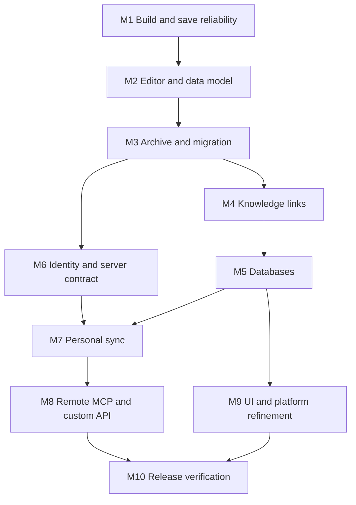

# Anamne — execution plan and remaining work

Last reviewed: **2026-10-15**. Current source: **0.2.1+3**, built on the supplied GLM 0.2.0 source. This plan records source presence separately from verified behavior.

Follow-up: the owner supplied local builds from the earlier source plus five local fixes. The editor hover fix is consolidated with the existing branch changes; see [the review](docs/reviews/2026-10-15-local-build.md). Server and artifact checks passed; real-device and manual sync/MCP gates remain open.

Read [prompt.md](prompt.md), [agent.md](agent.md), [docs/FIXES-0.2.1.md](docs/FIXES-0.2.1.md), [docs/LOCAL_BUILD.md](docs/LOCAL_BUILD.md) and [LOCAL_AI_PROMPT.md](LOCAL_AI_PROMPT.md).

## 1. Product and decisions

**Anamne** is an MIT-licensed personal knowledge workspace by **Invokeil Tech**. Keep the supplied icon/loading assets and **Powered by ©Invokeil Tech** attribution. The target is Notion-centered interaction with portable linked notes, offline editing, self-hosted sync and first-class API/MCP.

| Topic | Current implementation | Remaining gate |
|---|---|---|
| Client | Flutter; pinned SDK 3.47.7; app 0.2.1+3 | Analyze, tests, clean target builds and device QA for these fixes |
| Native Android | Flutter-generated project; release INTERNET permission | Production signing, file/share integration and Bengali IME QA |
| Local data | Sembast native, IndexedDB web; block JSON with Markdown projection | Unknown-block preservation, migrations and full archive restore |
| Server | Node.js 24 + built-in SQLite | Backup/upgrade recovery and operational QA |
| Sync | Ordered durable outbox, expected revisions, bounded retries, change cursor, conflict copies, purge tombstones | Multi-device client verification; history and recovery UI |
| Identity | SHA-256 token hashes; admin/editor/viewer; revoke/rotation | Secure client credential storage, expiry, device pairing and workspace isolation |
| MCP | 14 stdio tools; shared SQLite data | Standards-compliant authenticated remote transport and measured ≥99% operation coverage |
| UI | Block editor, links, graph, table/board, canvas source | Approved Notion reference inventory and measured visual/interaction comparisons |
| Targets | Web, Android arm64 APK, Linux x86_64 bundle/AppImage | Rebuild exact consolidated checkout and test install/upgrade; Windows/macOS later |
| Automation | GitHub workflow manual-only | Owner explicitly chooses if/when to run paid-minute jobs |
| Custom APIs | JSON properties and structured database API | Typed custom actions, schema validation, destinations, secrets and durable jobs |

The old Go/AGPL proposals in [docs/ROADMAP.md](docs/ROADMAP.md) are historical; the current server is Node.js and the license is MIT. No server rewrite is planned by this fix.

## 2. Source delivered and evidence

GLM supplied block/slash editing, wiki links/backlinks/graph, typed table/board databases, canvases, a sync outbox/engine, role tokens and Podman examples. Its reported Flutter test/build results were not reproduced in this environment. The supplied web artifact reported 0.1.0+1 while the supplied source reported 0.2.0+2; do not distribute it as a fresh build.

0.2.1 addresses page identity/pending-save errors, sync wire/retry/revision/conflict defects, atomic operation acknowledgement, descendant deletions, revoked/rotated tokens, web CORS, MCP block/canvas fields and UI database row IDs. It also supplies repeatable local setup/build commands. See the fix record for exact limits.

| Verification | Evidence at this fix |
|---|---|
| Server tests | 19 tests pass under Node.js 24.19.0, including injected acknowledgement failure and restart/revocation |
| Flutter regressions | Local builder reports 22 passes after analyzer/timer/hover fixes; reviewer did not independently rerun Flutter |
| Flutter analysis / target builds | Local builder reports clean analysis and Web/APK/AppImage builds; supplied artifacts inspected independently, not rebuilt here |
| Bootstrap/configuration checks | Local Python fixture and shell syntax checks; clean Flutter scaffold still requires a local SDK |
| Container / install / physical input QA | **Not run** here; Linux desktop startup was reported by the local builder only |
| Older GLM 0.2.0 web ZIP | Stale metadata; do not reuse. The later supplied 0.2.1+3 web artifact has correct metadata and report-matching checksum |

## 3. Status vocabulary

- **Source present**: implementation exists; platform behavior remains unverified until exercised.
- **Verified**: a named test/build/manual scenario passed with the recorded environment.
- **Partial**: a subset exists; its full acceptance gate remains open.
- **Missing**: the capability has no implementation in this source.
- **Blocked**: a specific missing dependency prevents an action; unrelated work can continue.

Unchecked milestone tasks below are acceptance work. A subset may already exist in source; inspect and verify it instead of rewriting it merely because its complete gate is unchecked. No product-completion or MCP-coverage percentage is claimed.

## 4. Immediate local continuation

1. Preserve any laptop checkout edits, clone/update `Invokeil/Anamne`, read the root agent instructions and inspect the exact commit.
2. Install/use Flutter 3.47.7, Node.js 24+, Python 3 and the actual host's target prerequisites.
3. Run `bash tool/build_local.sh check`; repair analyzer/test failures while preserving the regression scenarios.
4. Build web first, then Linux/AppImage and Android arm64 APK one at a time. Keep GitHub Actions manual-only.
5. Verify A→B editing, leaving database/canvas before debounce, save-error retry, offline/reopen, two-device conflict/delete and MCP→app round trips.
6. Record actual versions, commands, artifact paths/checksums and unverified items. Do not claim a physical-device pass from a compilation pass.

## 5. Remaining feature matrix

| Capability | State | Work required |
|---|---|---|
| Local workspace management | Partial | Multiple workspaces, selection/persistence and isolation |
| Durable page editing | Partial | Save/error/retry states, lifecycle flush and crash/reopen evidence |
| Page organization | Partial | Move/reorder/duplicate/favorites; documented tree deletion/restoration |
| Block editor | Partial | Block model + slash menu + block ops shipped; IME/device QA, undo/redo, image blocks remain |
| Attachments | Missing | Local files/images, metadata, safe paths and resumable sync |
| Native backup and restore | Missing | Archive manifest, checksums, import preflight and fresh-install restore |
| Markdown/Notion/CSV import | Missing | Mappers, stable IDs, fidelity report and unsupported-content preservation |
| Links/backlinks/tags | Partial | [[wikilinks]], backlinks panel, graph view shipped; tags and unresolved-link creation UX remain |
| Daily notes/templates | Missing | User-owned reusable structures and idempotent daily-note creation |
| Databases | Partial | Typed schema, records, table + board views, sort/filter shipped; relations/rollups and calendar/gallery remain |
| Board/list/gallery/calendar | Partial | Board shipped (drag between groups); list/gallery/calendar remain |
| Relations/formulas/rollups | Missing | Bounded evaluation and a documented supported subset |
| Graph | Partial | Force-directed graph with pan/zoom/drag shipped; node count bounded at 240 |
| User/device identity | Partial | Role-based hashed tokens with mint/revoke shipped; device pairing and scoped grants remain |
| Personal sync | Partial | Outbox + push/pull + idempotent replay + conflict copies shipped; multi-device testing and E2EE remain |
| History | Missing | Recoverable revisions, diff and restore policies |
| Public API contract | Partial | Machine-readable OpenAPI, complete schemas, pagination and error policy |
| Remote MCP | Missing | Authenticated transport, discovery, resource contexts and client tests |
| 99% MCP control | Missing | Operation register, feature parity, permission tests and measured coverage |
| Customized API | Partial | Existing JSON properties only; add typed schemas and safe HTTP actions |
| Webhooks/automations | Missing | Declarative triggers, durable jobs, preview/retry/audit |
| Selected Notion UI/UX matching | Partial | Notion-inspired block editor, sidebar, database and canvas shipped against DESIGN.md; measured reference comparison remains |
| Themes/density/fonts | Missing | Light/dark, settings, licensed fonts and text/accessibility scaling |
| Android integration | Missing | Share-to-note, file picker and lifecycle/permission handling |
| Desktop ergonomics | Partial | Shortcuts, tabs, command palette, window state and later split view |
| Offline web application | Missing | Reload cache/update strategy, storage diagnostics and recovery |
| Verified packages | Missing | Stable identity/signing, install/upgrade QA, checksums and release notes |
| Public multi-user hosting | Missing | Membership/permission isolation and operational gates; no open signup yet |
| Windows/macOS | Missing | Native scaffolds, integration, packaging and independent QA |

## 6. Dependency order



Reference collection and shared API/MCP commands begin with the relevant feature; they are not postponed until M8/M9. The later milestones consolidate coverage and polish. Link/database work can be bounded to a smaller supported subset if it blocks reliable sync and recovery.

## M1 — reproducible client build and truthful local save

**Priority:** P0. **State:** open. **Next implementation assignment.**

### Tasks

- [ ] M1.1 Inspect the active GitHub head, local changes, toolchains and actual Actions job logs/results.
- [ ] M1.2 Pin an available Flutter release and compatible resolved dependency set; document Node version and platform prerequisites.
- [ ] M1.3 Run bootstrap from a clean checkout; ensure it preserves source/tests and is safe to rerun.
- [ ] M1.4 Resolve analysis/test/build failures on an available target. Record blockers for unavailable targets separately.
- [ ] M1.5 Decide which native generated projects/configuration must become versioned before platform integrations; remove relevant ignore rules when adopting them.
- [ ] M1.6 Extract persistence/save state from the large UI file where needed for testability.
- [ ] M1.7 Show saving, durable-saved, error and retry states; do not show saved when a write has not completed.
- [ ] M1.8 Flush or persist drafts safely on page switch, route changes and app lifecycle transitions; surface write exceptions.
- [ ] M1.9 Test concurrent queued saves versus navigation, trash, restore and permanent deletion.
- [ ] M1.10 Define restoration when a child is restored under a deleted parent, and whether separately trashed descendants remain trashed when an ancestor is restored.
- [ ] M1.11 Add persistence/reopen tests, including Bangla and storage failure, using the same repository behavior as the app.
- [ ] M1.12 Start the UI reference-state inventory for navigation/editor/search on Android and desktop.

### Exit gate

A clean checkout produces a usable client on at least one verified target. A page can be edited, acknowledged as saved, reopened after restart and recovered from a simulated failed write. No known reproducible lost-save bug remains in that path. Other platforms are clearly marked unverified until their own builds and QA pass.

## M2 — structured editor and durable domain model

**Depends on:** M1. **State:** partial source; full exit gate open.

### Tasks

- [ ] M2.1 Write a short architecture decision for structured documents versus direct Markdown authority; retain the owner's Notion-centered priority.
- [ ] M2.2 Define workspace/page/block/property IDs, schema versions, block ordering and unknown-field preservation.
- [ ] M2.3 Evaluate a Flutter editor component with a small Android/Linux/Firefox/Chromium spike; record package version and license decision.
- [ ] M2.4 Implement an editor adapter; keep the portable schema independent of editor package internals.
- [ ] M2.5 Evaluate Drift/SQLite for native/web persistence, migration cost, browser requirements and failure behavior.
- [ ] M2.6 Migrate existing Sembast records with backup/recovery fixtures; preserve IDs and text exactly.
- [ ] M2.7 Add paragraph, heading, lists, tasks, quote, divider and code blocks with initial inline formatting.
- [ ] M2.8 Add slash menu, Markdown shortcuts, undo/redo, block conversion and reorder behavior.
- [ ] M2.9 Add safe image/file and callout blocks; retain originals and validate metadata.
- [ ] M2.10 Test Bangla IME, selection, paste, undo, emoji and mixed-script text on actual input systems.
- [ ] M2.11 Add domain commands, API schemas and MCP read/edit/append/move block operations for the supported block set.

### Exit gate

Supported rich documents round-trip through storage and schema serialization without loss. Existing plain pages migrate. Unsupported blocks survive editing. Android/Bengali and web/editor feasibility evidence is recorded before expanding the editor.

## M3 — recovery, portable archives and import

**Depends on:** M2; restore is required before sync rollout. **State:** missing.

### Tasks

- [ ] M3.1 Version a common native archive schema; reconcile client/server page-field differences first.
- [ ] M3.2 Add file-based export using platform save/share flows and web download, alongside readable Markdown.
- [ ] M3.3 Include manifests, checksums, page/block data, database placeholders and attachment bytes.
- [ ] M3.4 Add restore preflight, version validation, size/path protections and duplicate/conflict choices.
- [ ] M3.5 Restore a complete fixture into a fresh workspace and compare record counts, content, links and asset hashes.
- [ ] M3.6 Import the current `anamne.pages` JSON variants with explicit field mapping and migration diagnostics.
- [ ] M3.7 Add Markdown/frontmatter/wiki-link import and CSV parsing with documented supported subsets.
- [ ] M3.8 Add Notion Markdown/CSV ZIP import, preserving source and producing a fidelity report.
- [ ] M3.9 Add consistent server SQLite backup/restore and a documented upgrade rollback/recovery path.
- [ ] M3.10 Expose import preview, export, verification and restore planning through API/MCP with appropriate scope checks.

### Exit gate

A newly installed copy reconstructs a workspace from an archive. Corrupt, oversized and unsupported input fails recoverably with a report. No complete-backup claim is made before attachments and references are verified.

## M4 — organization and knowledge links

**Depends on:** M2/M3. **State:** partial links/backlinks/graph source; organization and reference gates open.

### Tasks

- [ ] M4.1 Finish move, reorder, duplicate, favorites and page-tree keyboard/touch operations.
- [ ] M4.2 Add stable wiki/page/block references, unresolved link states and duplicate-title disambiguation.
- [ ] M4.3 Add backlink/tag indexes maintained with page mutations and migrations.
- [ ] M4.4 Add template creation/application and configurable daily notes.
- [ ] M4.5 Replace whole-workspace linear search where measurements warrant an index; verify multilingual search semantics.
- [ ] M4.6 Add a command palette and basic desktop tabs preserving unsaved edits.
- [ ] M4.7 Add a neighborhood graph after navigation/index correctness is established.
- [ ] M4.8 Add API/MCP commands and resources for these supported operations.

### Exit gate

Rename/move/export/restore preserves references. Search/backlinks reflect edits and trash policy consistently. Templates and daily-note actions are idempotent under retries.

## M5 — databases and consistent views

**Depends on:** M2/M3. **State:** partial table/board source; full gate open.

### Tasks

- [ ] M5.1 Define typed property schemas, record identity, schema migrations and validation errors.
- [ ] M5.2 Implement a table with create/edit/delete, filter/sort, column controls and mobile cell editing.
- [ ] M5.3 Add page-reference properties and relation metadata without duplicating page records.
- [ ] M5.4 Add board and list views over the same data, including offline changes.
- [ ] M5.5 Add gallery/calendar only after the table/board/list contract is stable.
- [ ] M5.6 Define a bounded formula/rollup subset, dependency cycles and error reporting; defer unsupported functions explicitly.
- [ ] M5.7 Add schema/query/row/view operations to REST/MCP; preserve them in archives.

### Exit gate

One record edited in any supported view is consistent in every other view and after reopen/restore. Invalid typed data and evaluation cycles produce bounded, inspectable errors.

## M6 — identity, server contract and shared services

**Depends on:** M3 and the implemented domain scope. **State:** partial role/token and revision-safe sync contract; isolation remains missing.

### Tasks

- [ ] M6.1 Move HTTP/MCP handlers behind shared commands and validation; avoid duplicated business rules.
- [ ] M6.2 Publish OpenAPI and versioned cross-language page/block/property fixtures.
- [ ] M6.3 Introduce workspace ownership, user/device identity and membership boundaries; no public signup until isolation is tested.
- [ ] M6.4 Add scoped credentials, pairing, secure client token storage and revoke/expiry behavior.
- [ ] M6.5 Apply expected revisions/idempotency to all relevant mutations, including tree operations and imports.
- [ ] M6.6 Add durable revision/change history and a consistent cursor/pagination contract.
- [ ] M6.7 Add audit metadata, rate limits, request bounds and useful redacted error diagnostics.
- [ ] M6.8 Implement safe attachment metadata, hashing, resumable upload/download and access checks.
- [ ] M6.9 Review tree mutation atomicity, independently trashed descendants and multi-process SQLite behavior.
- [ ] M6.10 Add access-denial, conflict, rollback and malformed-input scenarios for both HTTP and MCP entry points.

### Exit gate

Two workspaces cannot read/write each other's data. Revoked credentials fail. The same permitted operation has equivalent results and errors through API and MCP. Revision history and backups are recoverable.

## M7 — connect app, server and MCP with personal sync

**Depends on:** M2/M3/M6 and chosen knowledge/database subset. **State:** partial outbox/push/pull source; multi-device gate open.

### Tasks

- [ ] M7.1 Persist a local outbox atomically with edits; allocate stable operation IDs.
- [ ] M7.2 Define push/pull requests, cursors, base revisions, acknowledgements and compatibility policy.
- [ ] M7.3 Add bounded batching, retries/backoff, reconnect, offline/auth errors and cancellation.
- [ ] M7.4 Preserve both sides of conflicts; implement revision diff and an explicit resolution UI.
- [ ] M7.5 Add tombstone retention, stale-device handling and delete/restore reconciliation.
- [ ] M7.6 Coordinate resumable asset sync and metadata availability without blocking text editing.
- [ ] M7.7 Show device/sync state, pending changes, retry and conflict actions truthfully.
- [ ] M7.8 Test phone and desktop offline edits, duplicate/reordered requests, server restart and upgrade with pending outbox entries.
- [ ] M7.9 Verify an MCP-created/edited page appears in the app after sync, and app edits appear through API/MCP.
- [ ] M7.10 Document first-time pairing, lost-device revocation, backup restore and resync behavior.

### Exit gate

The app and MCP operate the same logical workspace. Same-page offline edits on two devices are recoverable. Old devices cannot silently resurrect permanent deletions. No unacknowledged data disappears during reconnect or upgrade.

## M8 — complete MCP coverage, customized API and automation

**Depends on:** M6/M7; parity work also accompanies M2–M7. **State:** 14 stdio tools; blocks/canvas supported in create/update schema; parity unmeasured.

### Tasks

- [ ] M8.1 Adopt or verify a maintained MCP implementation and negotiated protocol versions; test malformed messages and lifecycle behavior.
- [ ] M8.2 Add authenticated Streamable HTTP for remote clients, with session/origin/authorization handling appropriate to the chosen spec.
- [ ] M8.3 Add typed tool input/output schemas and structured domain errors for every supported operation.
- [ ] M8.4 Add page/schema/search/sync/history resources and useful optional workflow prompts.
- [ ] M8.5 Create an operation register mapping UI → shared command → REST → MCP → scope → evidence.
- [ ] M8.6 Include workspace, block, database, file, import/export, history, settings and admin operations as those features ship.
- [ ] M8.7 Add scoped preview/apply behavior for destructive/bulk actions and approved external actions.
- [ ] M8.8 Extend custom properties into typed user-defined schemas with migrations and API exposure.
- [ ] M8.9 Add declarative custom HTTP actions with schema validation, destination controls, secrets and dry-run previews.
- [ ] M8.10 Add durable webhook/automation jobs, deduplication, retry/audit history and revoke/disable controls.
- [ ] M8.11 Test SSRF/redirect/oversize/error cases for external HTTP actions.
- [ ] M8.12 Compute MCP coverage using tested eligible operations; target ≥99% and require all critical operations.

### Coverage rule

`coverage = 100 × tested MCP operations / eligible implemented domain operations`.

Count an operation only after its success, validation, permission and relevant failure behavior is exercised. Record OS-bound exclusions separately. Do not equate 14 tools or an endpoint count with 99% application control. The current coverage is **not measured**.

### Exit gate

A real MCP client can complete the supported normal workspace journeys with documented scopes. Coverage evidence supports the claim, and remote/API actions preserve the same authorization and durability guarantees as the UI.

## M9 — measured UI/UX matching and platform refinement

**Depends on:** reference collection starts at M1; full flows depend on their features. **State:** editor/database/canvas source plus specification; measured reference comparison missing.

### Tasks

- [ ] M9.1 Build a reference ledger with approved Notion screens, platform/app version, viewport, theme, source/date and observed interactions.
- [ ] M9.2 Include empty, loading, editing, keyboard, selection, menu, offline, error and conflict states.
- [ ] M9.3 Use Stitch when helpful for a specified screen/flow; retain its actual output and conversion notes. Handle sign-in only when required.
- [ ] M9.4 Implement measured Flutter typography, spacing, navigation, control positions and transitions with Anamne assets.
- [ ] M9.5 Compare matching-size screenshots and interaction recordings; track discrepancies rather than declaring an unsupported exact match.
- [ ] M9.6 Add light/dark, density, text sizing, licensed Bengali fonts and persistent settings.
- [ ] M9.7 Add TalkBack/screen-reader semantics, focus order, keyboard-only operation, text scaling and reduced motion.
- [ ] M9.8 Add Android share-to-note, file access, background/lifecycle constraints and predictable Android back behavior.
- [ ] M9.9 Finish Linux Wayland/X11, shortcut/window and desktop integration behavior; add split view only after the editor is stable.
- [ ] M9.10 Add web storage diagnostics, offline reload/app-shell caching and update behavior that preserves pending edits.

### Exit gate

Named reference states have comparison evidence and accepted discrepancies. Bangla input and accessibility gates pass. No universal or unmeasured pixel/UX-equivalence claim is made.

## M10 — self-hosting, performance and public beta delivery

**Depends on:** agreed M1–M9 release scope. **State:** templates/workflow only.

### Tasks

- [ ] M10.1 Validate minimal single-user VPS install/upgrade/uninstall procedures on an actual supported host.
- [ ] M10.2 Benchmark server memory, peak operations, SQLite contention, backup/export/restore, disk growth and bounded concurrent clients.
- [ ] M10.3 Benchmark 1,000/10,000-note fixtures and a 2,000-block document with hardware/build details.
- [ ] M10.4 Fix measured typing/scrolling/search regressions; do not introduce compulsory services to mask them.
- [ ] M10.5 Pin build inputs, track native configuration deliberately, cache CI safely and avoid unnecessary documentation-only build cost.
- [ ] M10.6 Produce signed Android APK with stable identity/key handling; test install, upgrade and offline reopen on the target phone.
- [ ] M10.7 Produce AppImage with a supported runtime baseline; test dependency resolution and installation flow on representative Linux systems.
- [ ] M10.8 Publish web build only after HTTPS/offline/storage/update behavior is documented and verified.
- [ ] M10.9 Add release checksums, changelog, third-party notices, contributor guide, issue templates and a security reporting policy with a real contact.
- [ ] M10.10 Add privacy/diagnostic guidance; analytics/crash reporting must be optional and redact note content/secrets.
- [ ] M10.11 Verify fresh workspace restore and old-version upgrade on every claimed supported platform.
- [ ] M10.12 Publish a tagged beta with supported/unsupported features and known issues.

### Exit gate

Artifacts exist and have install/upgrade evidence. Core data-loss, permission, recovery and IME gates pass. VPS suitability is described from measurements. No release is called production-ready merely because CI is green.

## M11 — expansion after a dependable beta

Separate scoped milestones; these are not implicit requirements to complete before the first useful personal build.

- [ ] Windows build/integration/installer and platform QA.
- [ ] macOS build/integration/package and platform QA.
- [ ] Bidirectional Markdown folder bridge with conflict-safe external edits.
- [ ] Broader formulas/rollups, timeline and more advanced database queries.
- [ ] Larger graph, canvas/whiteboard and rich embeds.
- [ ] Capability-limited plugin SDK and reviewed extension lifecycle.
- [ ] Optional BYOK AI with custom/OpenAI-compatible providers and explicit content-sharing controls.
- [ ] Optional E2EE with complete key management, recovery and model-specific feature trade-offs.
- [ ] Team collaboration, sharing, comments, publishing and granular memberships.
- [ ] Optional managed hosting after capacity, billing/operations and user isolation are explicitly planned.

## 7. Release scenario register

All rows are open unless dated evidence is attached. Add test names, actual commands, platform and artifact/commit references as work progresses.

| ID | Scenario | Required outcome |
|---|---|---|
| R01 | Offline edit → acknowledged save → force close → reopen | Exact saved content recovered |
| R02 | Storage write failure/quota/disk full | Visible failure, recoverable draft, no false saved state |
| R03 | Bangla IME + formatting/selection/undo | Composition and content preserved |
| R04 | Rename/move/nested trash/restore | No cycles, lost links or undocumented descendant changes |
| R05 | Native archive → fresh install restore | Data/asset/link counts and checksums match |
| R06 | Import unsupported/corrupt/oversized input | Bounded failure and useful fidelity report |
| R07 | Two devices edit same page offline | Both revisions retained and reviewable |
| R08 | Duplicate/reordered push and server restart | Idempotent operations and durable cursor |
| R09 | Delete/restore vs stale-device reconnect | No silent resurrection or data loss |
| R10 | Revoked token or another workspace ID | Access denied without data disclosure |
| R11 | UI/API/MCP equivalent mutation | Same domain validation, permissions and revision result |
| R12 | Upgrade with pending local edits | Outbox, schema and recovery remain consistent |
| R13 | Browser offline reload/multi-tab/update | Content remains available, changes do not vanish |
| R14 | Android/Linux package install and upgrade | Stable identity, retained data, usable editor |
| R15 | Custom HTTP action hostile destination/error | Destination/secret controls hold; retries do not duplicate side effects |

## 8. Risks to resolve first

| Risk | Evidence or reason | Next resolution |
|---|---|---|
| Unverified client builds | SDK absent during foundation creation | M1 clean checkout and actual build logs |
| Save failure visibility/lifecycle loss | Debounced callbacks exist; no complete save-state UI | M1 persistence/lifecycle scenarios |
| Divergent client/server schema | Current client omits server version/properties/creation metadata | M2/M3 canonical schema and fixtures |
| Inconsistent tree semantics | Current store methods cascade broadly | M1/M6 explicit policy and regression scenarios |
| Superficial MCP validation | Manual stdio server handles only an initial protocol/tool subset | M6/M8 schema/protocol/permission review |
| Large workspace memory | Native Sembast and current lists load whole records | M2 storage choice and M10 fixtures |
| Backend rewrite churn | Old roadmap proposes Go; source is Node.js | Retain Node and measure first |
| Build-resource limits | Flutter/Gradle and multi-target CI are heavy | Use appropriate runner, caching and scoped build gates |
| UI mismatch | Reference screens have not been measured | M1/M9 reference ledger and screen comparisons |

## 9. Working cadence and evidence

Do not treat old rough week estimates as a deadline. Deliver one complete behavior at a time, with storage and API/MCP implications considered. Suggested first slices: clean client build → safe save/reopen → rich document serialization → archive restore → link navigation → table edit → paired-device sync → remote MCP parity.

For each completed task record:

```text
Task ID:
Commit:
Behavior delivered:
Schema / migration impact:
Commands and actual results:
Device / OS / build mode:
Screenshot or trace if relevant:
Known limitation:
Next task:
```

Relevant existing commands:

```bash
# Server checks (Node.js 24+)
cd server
npm test
```

```bash
# Client checks, only where Flutter and platform prerequisites are installed
bash tool/bootstrap.sh
flutter analyze
flutter test
flutter build web --release
flutter build apk --release
flutter build linux --release
bash tool/package_appimage.sh
```

These are commands to run with the needed environment, not a claim that all have passed. Keep APK signing material, API tokens and real user notes out of fixtures and commits.

## 10. Definition of done

An implementation item is done when its accepted behavior works, necessary failure cases are exercised, migrations/recovery are safe, supported platforms have evidence, and UI/API/MCP coverage or deliberate gaps are documented. Update this file and the README together when product status changes.

