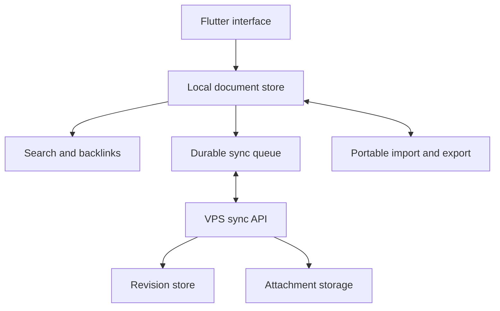
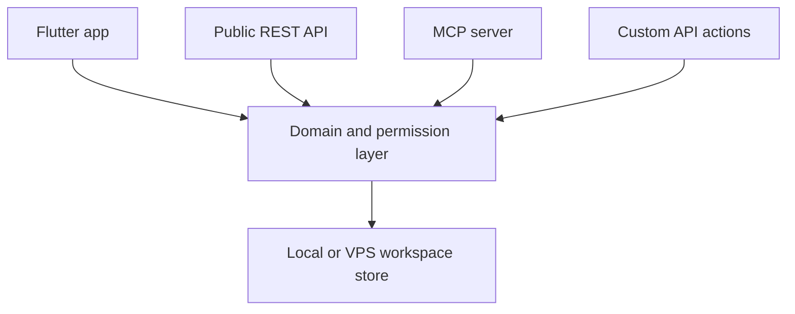

# Notion + Obsidian: Open-source workspace roadmap

Prepared for Himadri · 15 October 2026 · Planning document, version 1

> **Historical planning context.** The project is now **Anamne**. Use [Plan.md](../Plan.md), [prompt.md](../prompt.md), and [agent.md](../agent.md) for the current implementation brief. Existing source uses Flutter with Sembast client storage, a Node.js 24/SQLite server, and the repository's MIT license. Proposed Go/Drift/AGPL/name/directory decisions below are historical options unless explicitly adopted in the current plan. Feature tables below are proposed scope, not completion claims.

**প্রস্তাব:** Notion-এর পরিচিত page/block/database workflow, Obsidian-এর linking ও data portability, এবং নিজের server-এ sync—এই তিনটি নিয়ে একটি independent, local-first open-source app।

**Framework recommendation:** Flutter + Dart। Android-specific integration প্রয়োজন হলে ছোট Kotlin module। VPS-এ আলাদা Go sync service। Full AppFlowy server fork এই plan-এর default নয়।

এখানে “ofcidian” বলতে Obsidian ধরা হয়েছে। সব architecture, performance budget ও delivery estimate প্রস্তাবিত; কোনো app build, APK analysis, benchmark বা VPS deployment এই planning task-এ করা হয়নি।

## 1. Product direction ও প্রথম সিদ্ধান্ত

তোর Notion ভালো লাগে, তাই primary experience হবে page, blocks, nested navigation ও database views। Obsidian থেকে নেব local ownership, wiki links, backlinks, graph, daily notes, keyboard-driven work ও portable content।

প্রথম ব্যবহারকারী: একজন student/developer/personal knowledge user, যিনি phone ও Linux laptop-এ একই notes ব্যবহার করবেন। Software সবার জন্য open source হবে; প্রত্যেকে offline চালাতে বা নিজের server বসাতে পারবেন। সবার data তোর ছোট VPS-এ host করা প্রথম release-এর লক্ষ্য নয়।

প্রথম core loop:

1. App খুলে দ্রুত note লেখা।
2. Note-এর মধ্যে task, image, link ও structured property যোগ করা।
3. Search, backlink বা database view দিয়ে পরে খুঁজে পাওয়া।
4. Internet না থাকলেও কাজ চালানো।
5. Internet এলে নিজের অন্য device-এর সঙ্গে sync।
6. প্রয়োজন হলে readable export বা পূর্ণ backup নিয়ে বেরিয়ে যাওয়া।

প্রথম public beta-তে Android APK, Linux AppImage ও Web target থাকবে। Windows/macOS-এর জন্য shared core প্রস্তুত থাকবে, কিন্তু platform-specific build ও QA শেষ হওয়ার পরেই supported বলা হবে।

**প্রধান পার্থক্য:** সুন্দর mobile workflow, dependable offline editing, transparent self-hosting, এবং recoverable data। সব competitor feature একসঙ্গে যোগ করার বদলে এই চারটি প্রতিশ্রুতির acceptance test আগে সম্পূর্ণ করতে হবে।

## 2. বর্তমান product facts: পুরোনো ধারণা সংশোধন

| যাচাই করা তথ্য | এই project-এর সিদ্ধান্ত |
|---|---|
| Notion desktop/mobile apps-এ সব plan-এ offline pages আছে; browser-এ নেই। Subpage আলাদাভাবে download করতে হয়। Database-এর প্রথম view-এর প্রথম ৫০ row শুরুতে download হয়। | শুধু “offline আছে” differentiator নয়। Workspace-wide offline text/data এবং স্পষ্ট attachment controls লক্ষ্য। |
| Notion Markdown/CSV/HTML export করে; তাদের docs বলছে export re-upload করলেই পুরো workspace recreate হয় না। | Import fidelity report এবং আলাদা lossless native backup দরকার। |
| Obsidian Bases স্থানীয় Markdown ও properties থেকে database-like views তৈরি করে। | “Obsidian-এ database নেই” ধরে feature comparison করা যাবে না। |
| Obsidian free-to-use হলেও app code/assets-এর অধিকার তাদের; ব্যবহারকারীর content ব্যবহারকারীরই। | Own implementation, own branding এবং licensed dependencies। |
| Flutter Android, Linux, Web, Windows ও macOS target support করে। | Shared application core বাস্তবসম্মত; প্রতিটি platform-এর integration আলাদাভাবে যাচাই করতে হবে। |
| Kotlin Multiplatform এবং Compose Multiplatform এক জিনিস নয়। বর্তমান official table-এ Compose Web/Wasm Beta। | Kotlin-only Android strategy পুরো product-এর কাজ কমায় না; KMP সম্ভব হলেও default নয়। |
| AppFlowy-Cloud repository ১১ সেপ্টেম্বর ২০২৬ থেকে archived। Current self-host distribution commercial server codebase ব্যবহার করে। | Latest AppFlowy self-host server-কে fully open-source foundation ধরে কাজ শুরু করা যাবে না। |
| appflowy_editor reusable Flutter editor; তার LICENSE-এ AGPL-3.0 ও MPL-2.0 dual licensing আছে। | Editor component candidate হিসেবে evaluate করা যাবে; full cloud stack নেওয়া জরুরি নয়। |

Source links document-এর শেষে আছে। এগুলো ১৫ অক্টোবর ২০২৬-এ দেখা public documentation-এর অবস্থা; implementation শুরুতে chosen dependency release/commit আবার pin করতে হবে।

## 3. Flutter, Kotlin, নাকি অন্য stack?

| বিষয় | Flutter + Dart | Kotlin + Compose / KMP | Web UI + Tauri |
|---|---|---|---|
| Android UI | Custom design ও touch workflow-এর উপযোগী | Android integration-এর খুব ভালো পথ | Web editor embedding ও native bridge দরকার |
| Linux desktop | Supported target; AppImage packaging আলাদা | Compose Desktop সম্ভব; packaging আলাদা | Desktop packaging-এর একটি বিকল্প |
| Web | একই app core; editor/browser behavior পরীক্ষাযোগ্য | KMP web সম্ভব; shared Compose Web UI এখন Beta | DOM-based rich text editor-এর স্বাভাবিক পরিবেশ |
| Notion-like editor | appflowy_editor candidate | একই প্রয়োজনের editor implementation আগে যাচাই দরকার | Web editor ecosystem candidate হিসেবে মূল্যায়নযোগ্য |
| Team size | ছোট team-এর জন্য আমার default recommendation | Kotlin-অভিজ্ঞ team বা Android-first product হলে উপযোগী | Web editing প্রধান হলে বিবেচনা |
| প্রধান risk | IME, selection, huge documents, web persistence | Editor maturity, web UI ও shared integration | WebView input, OS integration, extra languages |

**Decision:** Flutter দিয়ে দুই সপ্তাহের feasibility spike। Android, Linux এবং Firefox/Chromium-এ একই rich-text document edit করিয়ে পরীক্ষা। বাংলা typing, selection, undo ও save/reopen pass করলে Flutter lock।

**Fallback:** Flutter editor যদি required web editing quality বা accessibility না দেয়, app shell-এ আরও feature যোগ করার আগে web-native editor approach পরীক্ষা। Flutter app-এর মধ্যে WebView ঢোকালে bridge, keyboard ও selection complexity বাড়ে—এটি বিনা খরচের fallback নয়।

Kotlin ব্যবহার করা যাবে Android share sheet, widgets, background work, file access বা অন্য platform integration-এর প্রয়োজনীয় অংশে। Notion-এর implementation language কী, তার ওপর নিজের framework নির্বাচন নির্ভর করবে না। APK analysis দিয়ে original backend, complete source বা Flutter widgets পাওয়া যায় না।

## 4. Reverse-engineering skills কীভাবে কাজে লাগবে

এই project-এর প্রয়োজন মূলত **product behavior ও interaction analysis**: user কোথায় tap করে, কোন action-এর ফল কী, error/offline state কেমন, আর একই কাজ নতুন app-এ কীভাবে ভালো করা যায়।

Publicly verified pack: [Jakeschincariol/replica-skill](https://github.com/Jakeschincariol/replica-skill)। এই plan-এ তার recon method অনুসরণ করে scope, proposed screen inventory, user flows, feature priority এবং uncertainty আলাদা করা হয়েছে। এই task-এ pack install/run করা হয়নি, আর Notion Android-এর measured UI audit-ও করা হয়নি।

| Skill/workflow | Implementation phase-এ ব্যবহার |
|---|---|
| replica-recon | Reference screens, user journeys, state inventory, observed বনাম inferred behavior |
| replica-architect | Existing project constraints মেনে schema, protocol ও architecture decision লেখা |
| replica-design | Own tokens/assets দিয়ে familiar interaction pattern implement করা |
| replica-test | Core flows ও failure cases-এর acceptance checks |
| replica-diff | Agreed feature matrix-এর completed/missing behavior দেখা |
| replica-brand | নিজস্ব নাম, assets ও product language রাখা |

APK/binary analysis-এর জন্য [EncidXVII/claude-reverse-engineering-skill](https://github.com/EncidXVII/claude-reverse-engineering-skill) আছে। এই product-এর initial workflow analysis-এ এটি প্রয়োজনীয় নয়; authorized interoperability বা concrete debugging problem হলে নির্দিষ্ট scope-এ evaluate করা যায়।

Skills instructions ও tools সাজায়; তারা missing requirements, sync correctness বা software ownership-এর প্রশ্ন নিজেরা সমাধান করে না। কোনো third-party skill ব্যবহার করার আগে তার SKILL.md, scripts, license ও install behavior review করতে হবে। Research/test skills যেন নিজে থেকে deploy, delete বা publish না করে।

প্রস্তাবিত analysis process:

1. Public docs, public screenshots এবং ব্যবহারকারীর দেওয়া recordings থেকে evidence সংগ্রহ।
2. প্রত্যেক observation-এ app version, platform, source ও date লেখা।
3. “Observed”, “inferred”, “proposed”, “not assessed”—এই চার status ব্যবহার।
4. UI behavior specification লেখা; private implementation সম্পর্কে অনুমানকে fact না বলা।
5. Own code, wording, icons ও branding দিয়ে implementation।
6. Interaction test দিয়ে তুলনা; cosmetic similarity percentage দিয়ে quality ঘোষণা নয়।

Notion-এর exact logo/assets/decompiled implementation নিয়ে public release এই plan-এর ভিত্তি নয়। Public behavior থেকে independently তৈরি app-এর জন্যও launch-এর আগে relevant license/branding/terms review লাগবে; “clean-room” শব্দ কোনো blanket legal guarantee নয়।

## 5. Feature roadmap: কোনটা কখন

| Capability | Personal MVP | Public beta | Later |
|---|---|---|---|
| Pages, nested pages, favorites, trash | Yes | Harden | — |
| Paragraph, headings, lists, checklist, quote, code, divider | Yes | Harden | — |
| Images/files, captions, safe links | Yes | Resume uploads | Advanced embeds |
| Slash menu ও Markdown typing shortcuts | Basic | Complete chosen set | Extensible commands |
| Tables, typed properties, filter/sort | Basic table | Stable | Advanced query language |
| Board ও list views | Basic | Stable | Grouping enhancements |
| Gallery ও calendar | — | Basic | Timeline |
| Relations, rollups, formulas | — | Small defined subset if ready | Broad functionality |
| Wiki links, backlinks, tags | Yes | Stable | Unlinked mentions |
| Daily notes ও templates | Basic | Stable | Template marketplace |
| Local full-text search | Yes | Tune | Semantic search |
| Graph | — | Local neighborhood graph | Large global graph |
| Offline app storage | Yes | Crash/migration tested | Large-workspace tools |
| Personal device sync | Early alpha after local core | Reliable conflict recovery | Realtime team collaboration |
| Markdown import/export | Yes | Fidelity reporting | Bidirectional folder bridge |
| Native complete workspace archive | Yes | Restore tests | Scheduled encrypted backups |
| Notion Markdown/CSV ZIP import | Initial subset | Better mapping/report | Public API connector |
| Tabs/split view | Desktop basic tabs | Split view if stable | More workspace layouts |
| Android share-to-note | Basic | Reliable | Widgets/quick settings |
| Keyboard commands ও command palette | Basic | Complete navigation | Custom mappings |
| Themes, density, font settings | Basic | Accessibility review | Theme extension SDK |
| Page publishing, comments, permissions | — | — | Collaboration phase |
| Canvas/whiteboard | — | — | Separate major milestone |
| Plugin runtime | — | — | Capability-based reviewed SDK |
| AI / OpenAI-compatible API | — | Optional after core | BYOK providers, citations |
| End-to-end encrypted sync | Design seam only | Optional only if reviewed and complete | Broader encrypted sharing |

এটি phase placement, completed feature claim নয়। Public beta-র stretch feature বাদ দিলে lossless save/restore বা offline correctness বাদ দেওয়া যাবে না।

“সব limitation বন্ধ” বলতে কোনো fixed artificial note count না থাকা, নিজের storage ব্যবহার, open code ও portable format বোঝানো যায়। Disk, bandwidth, device RAM, concurrent writes ও third-party API costs-এর বাস্তব সীমা থাকবে।

**Compatibility boundary:** Obsidian-এর existing JavaScript plugins, CSS snippets, Dataview queries, Bases বা Canvas files নতুন Flutter app-এ স্বয়ংক্রিয়ভাবে চলবে না। Markdown, frontmatter, wiki links এবং block references-এর supported subset প্রকাশ করতে হবে। Plugin ecosystem-এর feature equivalents তৈরি করা আর existing plugin binary/code চালানো আলাদা project; প্রথম release-এ compatible plugin runtime দাবি করা হবে না।

## 6. সবচেয়ে গুরুত্বপূর্ণ data decision: Markdown নাকি structured workspace?

| Model | সুবিধা | Trade-off |
|---|---|---|
| Markdown files authoritative | Plain editor/Obsidian-এ সরাসরি ব্যবহার সহজ | Rich blocks, stable references, database relations ও view state আলাদা format চাই |
| Structured document model authoritative | Notion-style rich editor/database consistent রাখা সহজ | Markdown export সব app semantics রাখতে পারবে না |
| Both independently authoritative | বাইরে থেকে দেখতে flexible | Two-way conflicts ও data loss risk খুব বেশি |

**Default recommendation:** যেহেতু তোর primary preference Notion, versioned structured document model authoritative থাকবে। Local SQLite-এ document ও metadata থাকবে; published schema-সহ native archive হবে complete portable backup। Markdown হবে readable export/import format।

এর মানে প্রথম release-কে “Obsidian-এর মতো সব data plain Markdown file” বলা যাবে না। এই পার্থক্য UI ও documentation-এ পরিষ্কার থাকবে।

Proposed portable archive contents:

- manifest.json: format version, workspace ID, export time, checksums।
- pages/: stable-ID document JSON; supported content-এর human-readable Markdown copy।
- databases/: property definitions, relations, rows, view configuration।
- assets/: original attachment bytes ও content hash।
- links/: page/block reference mappings।

Readable Markdown export-এ headings/lists/tasks/code/wiki links ও representable properties থাকবে। Rich columns, unsupported blocks, formulas, views বা comments plain Markdown-এ flatten হতে পারে। Export report-এ প্রতিটি loss/flattening লেখা থাকবে।

পরের Markdown folder bridge:

1. User explicitly folder connect করবে; external files-এর checksum/base revision রাখা হবে।
2. Filename বদলালেও page ID ও links যেন অযথা না ভাঙে।
3. External edit parse করে compatible content update করবে।
4. Unsupported rich metadata sidecar-এ থাকবে এবং round-trip contract documented হবে।
5. App ও external editor একই সময়ে edit করলে reviewable conflict তৈরি হবে।
6. Parse error বা unrecognized syntax-এর জন্য original bytes রাখা হবে।

যদি direct Markdown vault editing release-one-এর non-negotiable requirement হয়, এই decision বদলে Markdown-first architecture নিতে হবে এবং প্রথম database feature scope কমাতে হবে। দুটি route-এর trade-off লুকিয়ে একসঙ্গে “100% compatible” বলা যাবে না।

## 7. Recommended architecture

Typing/save/search-এর core path local থাকবে। Server unavailable হলেও app notes খুলতে ও edit করতে পারবে। Server কাজ করবে device sync, authentication, attachment transfer ও later sharing-এর জন্য।

| Layer | Proposed choice | Design constraint |
|---|---|---|
| UI | Flutter + Dart | Responsive mobile/desktop composition |
| State | Riverpod candidate | UI state ও durable data আলাদা |
| Editor | appflowy_editor candidate | Adapter-এর পেছনে; feasibility test আগে |
| Domain | Own versioned page/block/property model | Package-specific JSON পুরো product contract নয় |
| Native storage | SQLite via Drift | Transactional document + queue writes |
| Web storage | Drift SQLite/Wasm; browser-appropriate backend | Persistence detection, multi-tab protection |
| Search | SQLite FTS candidate | Bangla normalization/tokenization যাচাই |
| Backend | Go service | Small deployment surface, bounded work |
| Initial server database | SQLite | Single-node, limited workload; measure contention |
| File storage | Server filesystem first | S3-compatible adapter পরে |
| Transport | HTTPS API; bounded pull/push | Durable cursor, retries, idempotency |
| Deployment | systemd binary + reverse proxy | Docker Compose optional distribution |
| Later scale | PostgreSQL/object storage where measurements justify | Protocol stable রেখে migration |

Go/SQLite-এর resource suitability এখানে engineering hypothesis; actual implementation ছাড়া RAM বা supported user count guarantee নয়।

**Web-specific কাজ:** Flutter build করলেই offline PWA পাওয়া যাবে না। App shell caching, service worker lifecycle, asset versioning, offline reload এবং pending edit বাঁচিয়ে update করা implement করতে হবে। Flutter-এর current docs অনুযায়ী caching service worker এখন নিজে configure করতে হয়।

Browser storage quota/eviction, private browsing, multiple tabs ও unsupported persistence modes ধরতে হবে। Browser storage desktop filesystem-এর সমতুল্য নয়। “Saved locally” বলা যাবে শুধু durable write সফল হলে; unavailable হলে export/recovery option দিতে হবে।

## 7A. MCP, public API ও customized API — mandatory control plane

MCP optional plugin নয়; এটি product-এর first-class interface হবে। App UI, official API, এবং MCP একই domain/service rules ব্যবহার করবে—আলাদা hidden AI-only database বা backdoor endpoint নয়।

### 7A.1 Three integration surfaces

| Surface | Purpose | Contract |
|---|---|---|
| Flutter app API | First-party app sync, sign-in, attachment and page actions | Versioned internal client contract, never an undocumented privileged path |
| Public REST API | Scripts, integrations, mobile/desktop clients and community tools | Versioned `/v1` HTTPS API and published OpenAPI 3.1+ document |
| MCP server | ChatGPT, Claude, local agents and MCP-compatible tools control a permitted workspace | Standard MCP tools/resources/prompts through Streamable HTTP; local self-host can additionally offer stdio |

The OpenAPI document is the discoverable description for HTTP integrations; it supports client/server generation and test tooling. MCP exposes AI-oriented actions and readable workspace context. MCP uses explicit tool schemas and structured results, so every tool will declare input validation and output schemas.

### 7A.2 MCP capabilities

The following tool families are required before claiming “MCP controlled.” Tool names are draft names; the versioned schema, permissions, request limits, audit event and destructive-action behavior belong in the API contract.

| MCP tool family | Examples of control |
|---|---|
| Workspace | list/create/select workspace, workspace status, quota and server capabilities |
| Page and blocks | search, read, create, patch blocks, move, archive, restore, duplicate and append from a template |
| Knowledge | backlinks, links, tags, local search, graph-neighborhood query and daily-note creation |
| Database | create database, list schema, query/filter/sort, add or update row, create view and inspect formula errors |
| Files | upload/download/list asset metadata, attach/unlink from page, export selected pages |
| Import/export | inspect import before mutation, import archive/Markdown/CSV, full workspace export, backup verification and restore plan |
| Sync and history | device/sync health, pending changes, revisions, diff, conflict list and conflict-resolution proposal |
| User settings | theme, density, editor settings, command mappings and agent permissions |
| Automation | create/update/disable a user-owned rule or webhook subscription; every external write shows its destination and payload preview |
| Administration | only for instance admins: users, instance health, retention and server configuration; separate scopes from normal workspace tools |

MCP resources will expose read-only, addressable context such as `workspace://{id}/page/{id}`, `workspace://{id}/database/{id}/schema`, `workspace://{id}/sync/status` and versioned API documentation. They let an AI inspect content without forcing every read through a mutation tool. Prompts can provide guided operations such as “create a study plan from selected pages” while still calling only the caller’s permitted tools.

### 7A.3 “99% control” means this

An allowed agent can create, read, update, organize, search, import, export, inspect history, query databases and operate user-approved automations—the normal workspace work will be controllable through MCP.

The remaining device or consent boundaries are intentional: Android storage picker/share panel, OS notification permission, biometric prompt, app installation/update, first-time device pairing, password/passkey entry, and a user’s explicit confirmation for a deletion, external API write or data leaving the workspace. MCP can request these actions and show what will happen; it cannot silently take over the operating system.

### 7A.4 Permission and safety model

1. Each token binds to user, workspace, server and named scopes; it is never a permanent unrestricted master key.
2. Read, write, export, automation and administration are separate scopes.
3. Page-level permissions apply to API and MCP equally.
4. Every mutation uses idempotency key, expected revision and typed validation.
5. Delete, bulk edit, restore, full export and external send are previewable; user confirmation defaults on. A user may make a named automation pre-approved after seeing its exact scope.
6. Audit log records tool name, actor, target, time, result and change IDs—not unneeded page bodies or secret values.
7. Tool inputs, resource URIs and custom action outputs are validated; rate limits and timeouts apply.
8. API keys and external secrets are encrypted at rest where supported, never returned in plaintext after creation and never sent to an AI unless the user explicitly supplies/approves them.

This follows current MCP guidance that tools require input validation, access control, rate limits and sanitized output, while clients keep a human able to approve sensitive operations.

### 7A.5 Public API contract

Public endpoints will use `/v1`, JSON, cursor pagination, RFC 7807-style typed errors or an equivalent documented error envelope, optimistic concurrency (`revision`/ETag) and idempotency keys for mutations. Attachments use scoped resumable upload sessions; app clients do not receive server filesystem paths.

Initial endpoint groups:

- `/workspaces`, `/pages`, `/blocks`, `/databases`, `/views`, `/search`, `/links`
- `/assets`, `/imports`, `/exports`, `/revisions`, `/sync`, `/devices`
- `/webhooks`, `/automations`, `/api-keys`, `/mcp` discovery/configuration

Generated SDKs are a later convenience, not the only integration path. The source of truth remains OpenAPI plus behavior tests, and each breaking contract change gets a new major API version or a documented migration.

### 7A.6 Customized API

“Customized API” has two supported meanings:

1. **Custom app fields and views:** users define their own properties, database views and templates; API/MCP return a stable typed schema rather than hardcoded student/project fields.
2. **Custom HTTP actions:** a user/admin may register a named outbound HTTP action or webhook using a declared JSON Schema. It can be triggered from a page/button/automation/MCP call, has an explicit allowed host list, method, headers/secret reference, input mapping, timeout, retry policy and test mode.

The first release will not execute arbitrary user JavaScript, shell commands or containers on the VPS. That would turn a notes sync service into an unbounded code-hosting platform and exceed the small-server scope. Declarative custom actions provide useful API customization while remaining inspectable and controllable.

## 7B. Stitch-assisted Notion-parity design workflow

Stitch will be used as a design-specification and visual-prototype stage when the source screen inventory is ready. Its output guides Flutter implementation; it does not replace Flutter widgets, editor behavior, accessibility or device testing.

1. Build a reference ledger from public Notion documentation, store listings, publicly available videos and screens/recordings supplied from the user’s own account.
2. Mark each UI detail as observed, inferred, proposed or not-assessed; capture phone size, app version and state.
3. Feed the observed screen purpose, component states, interaction rules and own design tokens into Stitch. Generate mobile/desktop wireframes for one defined flow at a time.
4. Convert accepted output into Flutter component specification. Measure tap targets, typography, spacing, keyboard behavior and page states.
5. Compare Flutter screenshots and real-device interactions against the approved reference ledger. Fix differences that change usability before expanding scope.

“Exact match” will mean a named, measured screen/state list and interaction acceptance criteria—such as page navigation, block insertion, database editing, search and mobile back behavior. It cannot truthfully mean every Notion screen, private system behavior or every OS/font rendering before those are observed and specified.

The shipped app uses its own name, logo, illustration, wording and code. Common workspace patterns can be familiar; brand assets and copied proprietary content do not belong in the product.

## 8. Proposed domain model

এই schema নতুন product-এর proposal; Notion বা Obsidian-এর internal schema হিসেবে দাবি করা হচ্ছে না।

| Entity | Needed information |
|---|---|
| Workspace | ID, name, settings, schema version |
| Page | ID, parent ID, title, icon reference, position, current revision, trash state |
| Block | Stable ID, type, parent/ordering, rich content, typed attributes |
| PropertyDefinition | ID, name, type, options, relation target |
| PropertyValue | Page ID, property ID, typed value, revision |
| DatabaseView | ID, source, type, filters, sort, grouping, displayed fields |
| Link | Source page/block, target page/block, display label |
| Asset | ID/hash, MIME, bytes, transfer state, reference count |
| Change/Revision | Change ID, base revision, device ID, operation/body, server cursor |
| Device | Device ID, credential status, sync checkpoint |
| Snapshot | Workspace/page version, checksum, retention metadata |
| Membership | Later role/scope model; required before team sharing |

Stable IDs-এর কারণে rename/move-এ links এবং database relations টিকে থাকবে। Unknown future block types চুপচাপ delete না করে preserve করা হবে। Schema migration-এর আগে recoverable snapshot এবং backward-compatibility policy থাকবে।

## 9. Sync: data loss এড়ানোর বাস্তব পরিকল্পনা

প্রথম sync release হবে একজনের multiple device-এর জন্য। Simultaneous editing তবুও ঘটতে পারে; “একই user” মানেই conflict-free নয়।

1. প্রতিটি edit local transaction-এ document ও outgoing queue দুটোতেই durable হবে।
2. Server write-এ change ID ও expected base revision থাকবে।
3. Retry-এ duplicate change আবার apply হবে না।
4. Server acknowledged cursor durable storage-এর সঙ্গে transactionally advance করবে।
5. দুই device একই base থেকে একই page বদলালে উভয় revision রাখা হবে; safe merge সম্ভব না হলে conflict-copy/review UI।
6. Whole-document last-write-wins দিয়ে হারানো text ঢেকে রাখা যাবে না।
7. Delete হবে tombstone; restore ও stale-device return policy থাকবে।
8. Attachment transfer resumable, checksummed এবং note text sync থেকে independent।
9. “Saved on this device”, “Waiting to sync”, “Synced”, “Needs attention”—আলাদা state।
10. Server restart, expired credentials, full disk ও network change-এ queue resume করবে।

CRDT বা OT পরে শুধু library যোগ করে automatic collaboration হয়ে যাবে না। Rich text, block order, property conflicts, undo semantics, permissions, snapshots ও schema migration একসঙ্গে integrate করতে হবে।

যদি Google Docs-এর মতো live collaboration প্রথম version-এই দরকার হয়, phase-zero-তেই maintained collaboration engine-এর Dart/native/web compatibility spike করতে হবে। এই plan-এর revision protocol তখন বদলাবে এবং schedule পুনরায় estimate করতে হবে।

## 10. Privacy ও encryption

Initial private alpha-এর baseline: HTTPS, per-device revocable credentials, workspace authorization, secrets outside logs, এবং protected backups। Server plaintext content পড়তে পারলে সেটাকে end-to-end encrypted বলা যাবে না।

E2EE requirement-এর জন্য শুরুতেই opaque content envelope ও client-side indexing-এর interface রাখা হবে। Public release-এ E2EE ঘোষণা করার আগে key generation/storage, device enrollment, recovery, rotation, attachment encryption ও rollback protection review করতে হবে। Reviewed crypto libraries ব্যবহার হবে; নিজের encryption algorithm নয়।

E2EE থাকলে server-side search, server AI indexing ও anonymous publishing-এর design বদলাবে। AI feature-এ user-কে জানতে হবে কোন content কোন provider-এ যাচ্ছে। Local database encryption এবং transport encryption আলাদা capability।

Self-hosting data-এর operational control দেয়; নিজে থেকেই E2EE বা secure backup নিশ্চিত করে না।

## 11. Android ও desktop UI/UX brief

User wants a familiar Notion-like Android workflow. Exact current Notion navigation/layout এই task-এ interactively inspect করা হয়নি। নিচের screen map একটি proposed inventory।

| ID | Screen | Primary action | Required non-happy states |
|---|---|---|---|
| S01 | Local workspace / connect server | Start writing | Server unreachable, invalid address |
| S02 | Home / recent / favorites | Resume a page | Empty workspace, deleted recent |
| S03 | Page tree | Open/move/create subpage | Deep nesting, invalid move |
| S04 | Page editor | Write and format | Offline, save failure, unknown block |
| S05 | Block insert/action sheet | Add/change/move block | No selection, unavailable type |
| S06 | Database table | Add row/edit property | Empty table, invalid value |
| S07 | Board/list | Change grouping/status | Missing property, conflict |
| S08 | Search / command palette | Find or act | No results, index rebuilding |
| S09 | Backlinks / local graph | Explore connected notes | Broken target, no links |
| S10 | Properties/templates | Organize note | Invalid schema, duplicate property |
| S11 | Sync center | Inspect/retry/resolve | Expired token, conflict, quota |
| S12 | History / trash | Restore | Missing asset, old schema |
| S13 | Import/export | Bring or take data | Partial import, unsupported item |
| S14 | Settings / devices | Personalize/manage | Revoked device, incompatible server |

Design requirements:

- Mobile-first touch targets, keyboard-aware formatting bar ও accessible bottom sheets।
- Long press বা visible actions দিয়ে block move; scrolling-এর সঙ্গে gesture collision এড়ানো।
- Back navigation page hierarchy, search ও keyboard state অনুযায়ী predictable।
- Desktop-এ sidebar, keyboard navigation, tabs ও later split view।
- Comfortable/compact density, readable typography, dark/light theme।
- Bengali shaping, combining marks, mixed English/Bangla, emoji ও IME composition release blocker।
- Formatting toolbar যেন unfinished IME composition নষ্ট না করে।
- Motion ছোট ও purposeful: sheet transition, drag feedback, view change। Reduced-motion setting।
- Typing-এর সময় full page rebuild বা expensive backdrop blur নয়।
- Local content থাকলে network spinner-এর অপেক্ষা নয়।
- Screen-reader semantics, text scaling এবং keyboard-only editing পরীক্ষা।

## 12. Proposed user journeys

| Flow | Successful outcome | Key failure case |
|---|---|---|
| F01 Offline capture | Airplane mode-এ note লিখে restart-এর পর পাওয়া যায় | Crash during save |
| F02 Structured note | Paragraph থেকে checklist/code/image, undo/redo works | IME composition ও selection loss |
| F03 Organize | Page move/rename-এ links ও properties intact | Cyclic parent move |
| F04 Database work | Same data table/board/list-এ consistent | Concurrent property edits |
| F05 Knowledge linking | Wiki link resolve, backlink auto-update | Duplicate page titles |
| F06 Device sync | Phone/laptop offline edits both preserved | Same-page conflict |
| F07 Migration | Import report সহ selected source content arrives | Unsupported block/missing attachment |
| F08 Recovery | Fresh install-এ archive থেকে workspace rebuild | Corrupt archive or version mismatch |

## 13. VPS ও developer hardware strategy

আগের কথার তথ্য অনুযায়ী laptop-এ 8 GB RAM এবং VPS প্রায় 1 GB RAM। এই task-এ hardware live inspect করা হয়নি।

**VPS profile A — personal alpha:** একটি lightweight Go process, SQLite, small attachment directory এবং reverse proxy। প্রথমে একজন/কয়েকটি device; admission/load test ছাড়া public signup নয়। Existing services-এর পর available RAM কম হলে deployment defer বা আরও ছোট workload নিতে হবে।

**VPS profile B — small shared instance:** 2–4 GB class host একটি evaluation starting point; benchmark ছাড়া capacity দাবি নয়। DB write contention, active connections, attachment volume ও backup time দেখে sizing।

**Public open-source distribution:** Source, APK/AppImage, self-host instructions ও tagged releases সবার জন্য। প্রত্যেকে নিজের instance চালাবেন। এটি তোর VPS-এ unlimited free hosted accounts দেওয়ার প্রতিশ্রুতি নয়।

Development:

- Heavy APK/desktop builds production VPS-এ নয়।
- Local editor + একটি target একসঙ্গে; real Android phone দিয়ে test করলে emulator-এর RAM চাপ কমানো যায়।
- CI build artifacts version-tagged হবে; build-minute/provider limits implementation-এর সময় verify।
- Flutter/Rust/Gradle সব একসঙ্গে compile করা full app fork-এর বড় local cost।
- AI-assisted coding remote API দিয়ে করা যায়; local LLM বাধ্যতামূলক নয়।
- R2/S3 optional attachment backend; core functioning কোনো particular cloud vendor-এর ওপর নির্ভর করবে না।

Recurring cost software license ছাড়াও storage, traffic, backups, email, build time ও optional AI usage থেকে আসতে পারে। “Open source” থেকে “zero hosting bill forever” অনুমান করা যাবে না।

## 14. Delivery phases ও exit criteria

নিচের সময় experienced, focused developer-এর engineering estimate; AI-assisted coding থাকলেও QA/review বাদ যায় না। কাজ শেখা, part-time সময় বা নতুন sync engine হলে সময় বাড়বে।

| Phase | Approximate focused effort | Deliverable | Exit gate |
|---|---|---|---|
| 0: Scope + feasibility | 1–2 weeks | Product brief, evidence map, editor/storage spikes | Android/Linux/Web-এ Bangla editing, save/reopen, schema decision pass |
| 1: Offline foundation | 3–5 weeks | Pages, core blocks, local persistence, search, trash, export | Offline restart/crash recovery; stable IDs; backup restore |
| 2: Organization | 3–5 weeks | Basic database, links/backlinks, templates, page tree | Views consistent; rename/move preserves references |
| 3: Personal sync + migration | 4–6 weeks | VPS service, device pairing, queues, conflicts, Notion/Markdown importer | Two-device offline conflict, duplicate retry, missing assets recovered |
| 4: Public beta | 3–5 weeks | APK, AppImage, Web, docs, telemetry opt-in, release pipeline | Security/data durability/accessibility and compatibility gates |
| 5: Version 1 stabilization | Additional 6–10 weeks | Bugs, migration tools, more database features, measured performance | No known critical data-loss/security bugs; verified restore path |
| 6: Expansion | Separate planning | Windows/macOS, collaboration, canvas, plugins, optional AI | Each capability has its own feasibility and release gate |

Phases 0–4: roughly 14–23 focused developer-weeks, approximately 3.5–6 months. Personal useful builds arrive earlier during phases 1–3. A credible stabilized version 1 could be roughly 5–8+ months for an experienced focused developer; a solo learner working part-time should budget 9–18+ months. These are scope estimates, not deadlines or delivery guarantees.

## 15. Performance budget ও meaningful tests

এসব proposed targets; measured results নয়। প্রথম benchmark-এর পর adjust করতে হবে, এবং test dataset ও hardware লিখে রাখতে হবে।

| Area | Initial target / gate |
|---|---|
| Smooth editing | Reference devices-এ ordinary edits/scrolling 60 fps goal; p95/p99 frame time record |
| Local page open | Small cached note approximately 300 ms target after warm start |
| Local search | 10,000-note fixture-এ typical query approximately 200 ms target |
| Cold start | Representative native devices-এ usable editor approximately 2 seconds goal |
| Save truthfulness | Successful durable save-এর আগে “saved” state নয় |
| Large notes | 2,000-block stress document; memory/edit latency report, graceful limits |
| Browser | Firefox and Chromium; offline reload, storage denial, multi-tab and update recovery |
| Server | Measured idle/peak RSS, write latency, connection count, disk growth ও restore time |

Fixtures: normal workspace (1,000 notes), large workspace (10,000 notes), long document (2,000 blocks), mixed Bangla/English/emoji, attachments এবং deep page trees। Attachments unbounded হলে memory target অর্থহীন; sizes record করতে হবে।

Release-blocking tests:

1. Force-close after acknowledged local save, তারপর restart।
2. দুই device একই page offline edit; দুই version recoverable।
3. Reordered/duplicated sync requests, network loss এবং server restart।
4. Delete/restore বনাম stale device reconnect।
5. Disk full, browser quota exhausted, expired credentials।
6. Old app/new server compatibility ও migration rollback/recovery।
7. Native archive export -> fresh install -> import; content/asset/link counts verify।
8. Unauthorized workspace access, attachment access ও revoked device request rejection।
9. Bangla IME composition, undo, selection, paste এবং accessibility navigation।
10. App upgrade-এ pending edits বা local queue হারায় না।

Critical data integrity tests business behavior পরীক্ষা করবে; implementation mirror করে superficial test count বাড়ানো নয়।

## 16. Platform packaging

| Target | Deliverable | Release considerations |
|---|---|---|
| Linux | x86_64 AppImage first | Supported glibc baseline, bundled dependencies, Wayland/X11, desktop integration |
| Android | Signed APK, ARM64 first; other ABI as tested | Stable application ID/signing key, share intents, background sync behavior |
| Web | Versioned HTTPS static build + API configuration | Service worker, browser persistence, cache migration, deep links |
| Windows upcoming | Installer/package selected later | Windows runner, file paths, signing/update strategy |
| macOS upcoming | macOS package selected later | Mac build environment, architecture testing, signing/notarization plan |

AppImage মানে সব Linux version/CPU-তে guaranteed run নয়। Tested distro/architecture list প্রকাশ করতে হবে। Elementary/Ubuntu-family এবং Fedora-তে focused QA করা যুক্তিযুক্ত।

এক codebase মানে এক machine থেকে সব desktop binary build বা সব native integration automatic নয়।

## 17. Open-source project governance

নিজস্ব code-এর জন্য provisional recommendation AGPL-3.0 যদি hosted modified versions-এর source availability গুরুত্বপূর্ণ হয়। MPL-2.0 alternative হতে পারে file-level sharing model চাইলে। Final license dependency inventory এবং distribution goals দেখে lock করতে হবে।

Full AppFlowy app/server fork, editor component এবং independent code-এর licensing এক ধরে নেওয়া যাবে না। appflowy_editor-এর dual-license text ও pinned release পরীক্ষা করে chosen licensing path record করতে হবে।

Public release package:

- LICENSE, dependency notices ও third-party asset list।
- Source থেকে repeatable documented build।
- Local-only এবং self-host setup guide।
- Backup/restore এবং upgrade guide।
- Versioned data format ও sync protocol documentation।
- SECURITY.md, vulnerability reporting contact, contribution rules ও code of conduct।
- Release checksums, signing process, changelog এবং supported platforms।
- Issue templates with app/server/schema versions; logs-এ note content/credentials default-এ নয়।

Open-source distribution, donated support ও optional managed hosting coexist করতে পারে। Core offline use/export/self-host path account বা subscription-এর ওপর নির্ভর না করাই এই product-এর proposed promise।

## 18. প্রথম দুই সপ্তাহের concrete work plan

| Days | Work | Reviewable result |
|---|---|---|
| 1–2 | Reference evidence, user flows, MVP scope | Versioned brief ও must/should/later matrix |
| 3–4 | Flutter editor prototype on phone/Linux/Web | Bangla composition, selection, clipboard, undo findings |
| 5–6 | Local storage and schema prototype | Save/reopen, rollback, unknown-block preservation |
| 7–8 | Small database + links prototype | Same page appears in table and backlink view |
| 9–10 | Two-device conflict simulation | Both offline revisions retained; conflict behavior specified |
| 11–12 | Export/import prototype | Readable Markdown and full native archive round-trip |
| 13–14 | Measure, resolve risks, decide stack | Architecture decision and prioritized implementation backlog |

এই gate-এর শেষে editor/web feasibility fail করলে core UX/stack adjust করতে হবে। AppFrame, colors ও animation নিয়ে মাসখানেক কাটানোর আগে text/data path কাজ করছে কি না নিশ্চিত হবে।

## 19. AI-assisted implementation rules

একটি complete specification AI-কে দেওয়া যাবে, কিন্তু delivery ছোট vertical slice-এ হবে। প্রতিটি slice-এর concrete behavior, migration impact ও acceptance criteria থাকবে।

Proposed repository organization:

- apps/client_flutter: application shell ও platform adapters।
- packages/domain: page/block/property schema, validation, migrations।
- packages/editor_adapter: chosen editor integration।
- packages/storage: native/web persistence implementations।
- packages/sync_client: queue, protocol, conflict state।
- server/sync: Go API, authorization, storage।
- docs: product brief, architecture decisions, protocol, format ও release instructions।
- test_fixtures: synthetic multilingual workspaces and import examples।

এই document কোনো repository সৃষ্টি করেনি; উপরের paths ভবিষ্যৎ structure proposal।

AI developer-কে দিতে হবে:

1. কোন feature করতে হবে, কেমন behavior pass করবে।
2. Existing model/protocol-এর invariants।
3. Own-code/licensing constraints।
4. Reference screenshot/recording-এর provenance।
5. Measured performance budget, environment ও datasets।
6. Pending questions ও intentionally unsupported behavior।

প্রথম implementation brief হবে: “একটি offline page তৈরি, বাংলা লিখে format করা, local save, process বন্ধ করে reopen, Markdown export ও native archive restore।” এটি end-to-end চলার পর database ও sync expand হবে।

## 20. Decisions that remain open

এগুলো planning-কে আটকে রাখেনি; নিচের defaults ধরে roadmap লেখা হয়েছে।

| Decision | Current default | When to change |
|---|---|---|
| Notion-rich document vs plain-file authority | Structured model + transparent exports | Direct Markdown vault editing mandatory from day one হলে |
| Personal sync vs live teamwork | Personal multi-device first | Realtime team use primary requirement হলে |
| Mandatory server | Self-hosted server available; local use works without it | Centrally managed workspace primary হলে |
| Framework | Flutter after feasibility gate | Web editor/accessibility gate fail হলে |
| Editor dependency | appflowy_editor candidate | Maintenance/API/IME/license evaluation fail হলে |
| E2EE | Architecture prepared; no premature claim | Privacy requirement demands encrypted-sync milestone before release হলে |
| License | AGPL-3.0 provisional | Contribution/distribution strategy ও dependency review অনুযায়ী |
| Hosting for everyone | Each user self-hosts or runs locally | Funding/operations support managed hosting হলে |
| Product name | Not decided | Trademark/domain review ও own branding phase-এ |

## 21. Sources checked

Primary sources are separated from the design recommendations above. Documentation establishes current product/framework facts; it does not benchmark this proposed app.

1. [Notion: Use pages offline](https://www.notion.com/help/use-pages-offline)
2. [Notion: Export your content](https://www.notion.com/help/export-your-content)
3. [Obsidian: Introduction to Bases](https://obsidian.md/help/bases)
4. [Obsidian: License overview](https://obsidian.md/license)
5. [Obsidian: Sync security and privacy](https://obsidian.md/help/sync/security)
6. [Flutter: Supported deployment platforms](https://docs.flutter.dev/reference/supported-platforms)
7. [Flutter: Web FAQ](https://docs.flutter.dev/platform-integration/web/faq)
8. [Flutter: Linux deployment](https://docs.flutter.dev/deployment/linux)
9. [Kotlin: Stability of supported platforms](https://kotlinlang.org/docs/multiplatform/supported-platforms.html)
10. [AppFlowy application repository](https://github.com/AppFlowy-IO/AppFlowy)
11. [Archived AppFlowy-Cloud repository and migration notice](https://github.com/AppFlowy-IO/AppFlowy-Cloud)
12. [AppFlowy SelfHost Commercial repository](https://github.com/AppFlowy-IO/AppFlowy-SelfHost-Commercial)
13. [AppFlowy Editor repository](https://github.com/AppFlowy-IO/appflowy-editor)
14. [AppFlowy Editor license](https://github.com/AppFlowy-IO/appflowy-editor/blob/main/LICENSE)
15. [AppFlowy Editor package](https://pub.dev/packages/appflowy_editor)
16. [Drift: Web persistence](https://drift.simonbinder.eu/platforms/web/)
17. [Riverpod: Getting started](https://riverpod.dev/docs/introduction/getting_started)
18. [AppImage: Concepts](https://docs.appimage.org/introduction/concepts.html)
19. [Tauri: Introduction](https://v2.tauri.app/start/)
20. [Replica skills repository](https://github.com/Jakeschincariol/replica-skill)
21. [Replica recon workflow](https://github.com/Jakeschincariol/replica-skill/blob/main/replica-recon/SKILL.md)
22. [Reverse engineering skill repository](https://github.com/EncidXVII/claude-reverse-engineering-skill)

The plan is deliberately independent of either vendor's backend. Its next concrete milestone is the editor/local-storage feasibility prototype, followed by a decision record based on the results.
